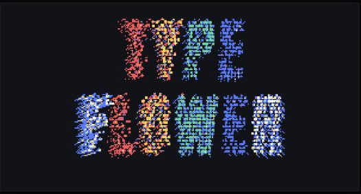
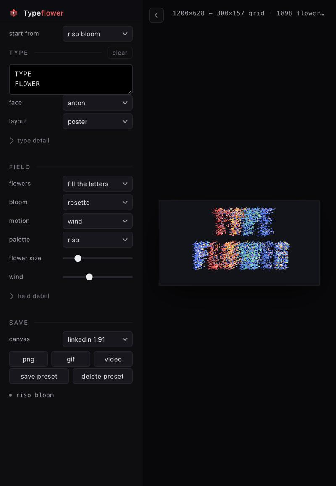

# Typeflower

**[Open the tool →](https://udayx.github.io/typeflower/)**

Type something. It grows back as a field of geometric flowers, dithered to a six-colour palette and moving in a wind that is entirely made up.



One HTML file. No build step, no dependencies, no server — open it and it runs.

## Run it

```bash
open index.html
```

Or use the hosted copy at **[udayx.github.io/typeflower](https://udayx.github.io/typeflower/)** — same file, nothing else to install.

## What it does

1. **Sets the type** on an offscreen canvas — your text, your face, your tracking and leading.
2. **Samples it on a grid** and keeps the cells the letters actually cover.
3. **Grows a flower in each cell**, sized by how much ink that cell holds, swaying per letter.
4. **Dithers the whole frame** with an 8×8 Bayer matrix down to the palette, then scales it up with hard pixel edges.

Nothing is a filter over a bitmap — the letters are typeset, sampled and rebuilt every time you change a control.



## Controls

| Group | What it does |
|---|---|
| **type** | Text, 8 system faces plus 10 web faces, weight, case, poster or paragraph layout, tracking, leading, alignment |
| **field** | Flowers fill the letters or get cut out of a full field; 6 motion presets; canvas size; palette; ink strategy; dither amount; pixel size; flower size; wind; petal shape; stems; halos |
| **presets** | Four built-in looks, plus your own saved to this browser |
| **export** | PNG, GIF, MP4 — all at the canvas size, not the window size |

Drag a `.ttf`, `.otf`, `.woff` or `.woff2` anywhere on the page to set your text in your own font. Nothing is uploaded; the file stays in the page.

## Legibility

Flowers are a terrible way to draw letters, so most of the work is making them readable anyway:

- The cell size follows the **measured stroke weight** of the face, so a hairline script gets a finer grid than Anton does.
- A letter always gets about **9 cells across its advance** — if the type is too small for that, the dither grid upscales itself instead of giving up.
- Edge flowers **sit on their share of the ink** rather than in the middle of their cell, which keeps the silhouette instead of stair-stepping it.
- Petals never cross a cell boundary, and each head can be ringed in the background colour so neighbours stay separate.
- `ink: one per letter` gives every letter its own colour — the single biggest readability win in the whole tool.
- `dither: 0` cuts letter edges clean; `100` stipples them with the full Bayer pattern.

## Exports

| Format | Size | Notes |
|---|---|---|
| PNG | exactly the canvas preset | up to 3840×2160 |
| GIF | integer-scaled, long side ≤ 1080 | ~2.3 s loop, encoded in-page — no library, because the frames are already palette-indexed |
| MP4 | canvas preset, long side ≤ 1920 | 5 s via `MediaRecorder`; falls back to WebM where MP4 recording isn't supported |

## Browser support

Chrome, Edge and Arc are the happy path. Safari and Firefox render and export PNG and GIF; MP4 recording depends on the browser's `MediaRecorder` codecs, and the tool reports what it actually saved. Local storage for presets is skipped gracefully when a browser blocks it for `file://`.

## Tests

Open `index.html?selftest`, or call `selftest()` in the console. It runs ten checks — flowers grow, knockout inverts, paragraphs wrap, motion stays finite, every pixel is a palette colour, GIFs decode back pixel for pixel, PNGs come out at the canvas size, junk fonts are refused, presets restore every control — and prints a table.

## License

MIT — see [LICENSE](LICENSE).
